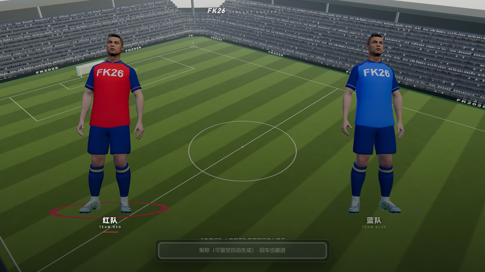

# 足球盛宴 · Violent Soccer

3D 第三人称足球，但允许铲抢、冲撞和倒钩。三十人的动作库、服务端权威的球体物理、电视转播级的镜头与后处理。

**2–12 人联机 · 30Hz 权威主循环 · 支持观战与语音**

---



---

## 玩法

3D 第三人称足球，但规则比现实宽松得多：可以滑铲、可以冲撞、可以倒钩。场上有完整的守门员 AI 与队友 AI，人数不够时自动补位。

**踢球不是"碰到就踢"。** 你要先用方向键把击球点红点挪到球附近，再用鼠标上下控制射门仰角——看天就是高球上吊，看地就是贴地抽射。蓄力越久球速越快，但对手也会读你的动作。

带球有吸附机制，高速跑动时球会贴脚。按 `Q` 在「踢球」和「攻击」之间切换，攻击状态下可以撞开防守球员，代价是失去控球。

守门员会根据球的轨迹预判扑救，而且**动作和判定是绑定的**——模型没扑到就不会拦下球。

## 操作

| 按键 | 作用 |
|---|---|
| `WASD` | 移动 |
| `Shift` | 疾跑 |
| `Ctrl` | 慢走（精细控球） |
| `空格` | 跳跃 |
| 方向键 | 移动击球点红点（移动时不再控制角色） |
| 鼠标上下 | 调整射门仰角：看天=高球上吊，看地=贴地球 |
| 鼠标侧键 + 移动 | 调整击球方向 |
| `C` | 滑铲 |
| `Q` | 切换「踢球 ↔ 攻击」；跳舞模式下变为选舞转盘 |
| `ESC` | 解除鼠标锁定 |

## 这里有什么

一个把「足球游戏的手感」当成正经工程问题来做的项目。球不是简单的刚体，球员也不是只会滑动的胶囊体。

| 模块 | 说明 |
|---|---|
| **权威主循环** | 服务端 30Hz 固定步长推演球体物理与球员状态，客户端插值渲染。所有判定以服务器为准 |
| **动作系统** | `glb/` 下 60+ 个烘焙动作（跑动、铲球、倒钩、守门员扑救、庆祝舞蹈），通过 `anim-pick.js` 按状态机挑选，配合 `rootmotion.json` 做根位移对齐 |
| **守门员 AI** | `bw-guard.js` + `gk-reach.json`：按射门角度与球速预测落点，扑救动作有真实的够到 / 够不到边界 |
| **盘带手感** | `dribble-idle.json` / `spin-ball.json` 定义触球节奏与旋转，转向模型参考主流足球游戏的「车速式」转向曲线 |
| **转播镜头** | `postfx.js` 做景深、色差、暗角与色彩分级，模拟电视转播观感 |
| **程序化角色** | 角色卡面用 CSS + SVG 实时绘制，不依赖任何图片素材 |

## 关于素材

**请先读这一段，再决定怎么用。**

- 仓库包含 60+ 个从 **Mixamo** 烘焙的骨骼动画（`.glb`）。Mixamo 素材可随项目分发，但不可单独再分发动画文件本身。
- 球员庆祝语音、以及指向真实球员的模型资源，**已从本仓库移除**。想恢复该功能，请自行准备音频放入 `audio/`，命名 `cheer-1.mp3` 与 `cheer-2.mp3` —— 代码在文件缺失时会静默跳过，不影响游戏运行。
- 模型内部的骨骼节点名已做匿名化处理（`generic_player_01` 等），不含任何真实人物标识。
- 角色、球队、联赛均为虚构。

**结论**：代码可以放心用，美术资源请自行确认授权后再商用。

## 快速开始

需要 **Node.js 18+**。

```bash
npm install
npm start
# → http://localhost:3000
```

可选：启用 HTTPS（语音通话需要）

```bash
HTTPS_PORT=3443 npm start
```

## 操作

| 按键 | 功能 |
|---|---|
| `WASD` | 移动 |
| `空格` | 跳跃 |
| 左键 | 踢球 |
| `Shift` | 冲刺 |
| 鼠标中键 | 庆祝 / 舞蹈转盘 |

## 目录

```
足球盛宴/
├── server.js            # 权威服务端：物理循环、房间、判定
├── public/
│   ├── js/main.js       # 客户端主逻辑
│   ├── js/character.js  # 角色状态机与动画混合
│   ├── js/card.js       # 程序化球员卡（SVG）
│   ├── js/postfx.js     # 转播级后处理
│   ├── js/world.js      # 球场与环境
│   └── js/input.js      # 输入与镜头
├── glb/                 # 烘焙后的骨骼动画
├── anim-pick.js         # 动作选择与根位移对齐
├── bw-guard.js          # 守门员 AI
└── rootmotion.json      # 根位移参数表
```

## 授权

代码 MIT。素材授权见上文「关于素材」一节。

---

这个项目是 [AI Arcade](../README.md) 合集的一部分，也可以独立运行。
